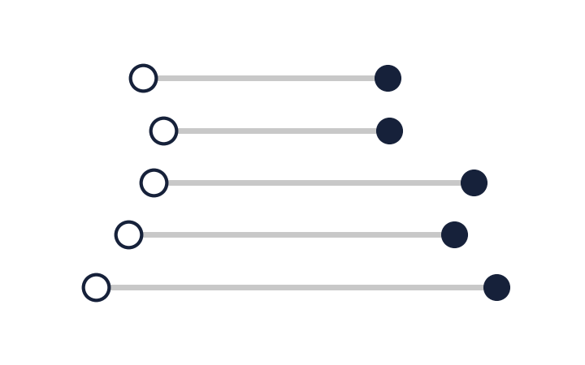
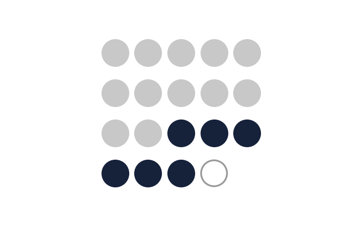
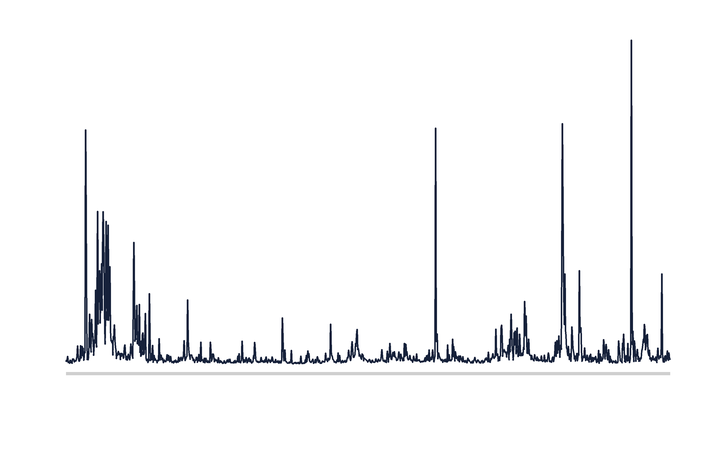
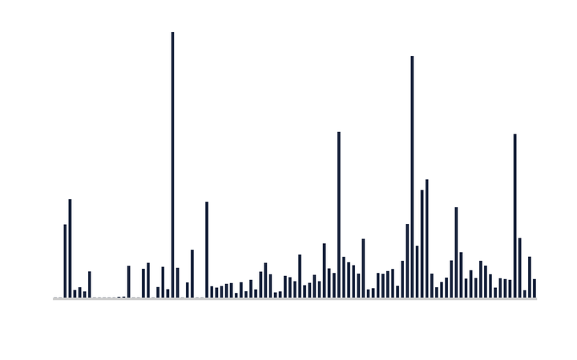
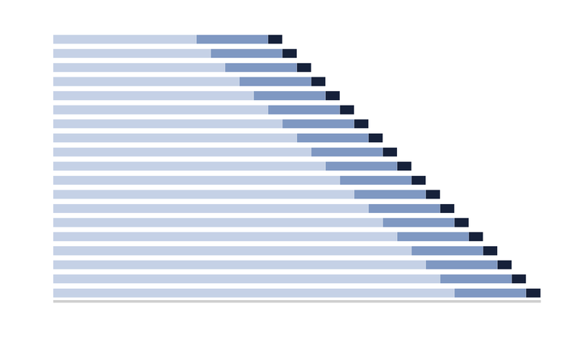



Each project answers a question that portfolio managers meet in practice, on public data or, where the question needs them, on licensed data. Its expectations and thresholds were written into its repository before the code that tests them ran, and its code marks what was added after the results were known. Its note gives the question, the data, the method and the result, null results included, with a link to the repository that holds the code behind every figure.

Portfolio construction

<a href="/projects/optimal-vs-naive-diversification/">Optimal versus naive diversification</a>

Under a long-only index-tracking mandate on French's 49 industries, 1979 to 2026, each of five covariance estimators forecasts less tracking error than its portfolio realises: the realised active return is 22 to 61 per cent more volatile than forecast. The replication of DeMiguel, Garlappi and Uppal (2009) reproduces 29 of the 30 out-of-sample Sharpe ratios it tests within 0.03 of the published values, 26 of 27 with the value-weighted market counted once.

<a class="btn btn--info btn--small" href="https://www.carlohofer.com/optimal-vs-naive-diversification/dashboard/B-P_dashboard.html" target="_blank" rel="noopener"><i class="fas fa-chart-line" aria-hidden="true"></i> Dashboard</a> <a class="btn btn--info btn--small" href="https://www.carlohofer.com/optimal-vs-naive-diversification/note/B-P_note_2026-10.pdf" target="_blank" rel="noopener"><i class="fas fa-file-pdf" aria-hidden="true"></i> Note (PDF)</a> <a class="btn btn--inverse btn--small" href="https://github.com/ochofer/optimal-vs-naive-diversification" target="_blank" rel="noopener"><i class="fab fa-github" aria-hidden="true"></i> Code on GitHub</a>

Ownership and prices

<a href="/projects/climate-risk-equity-signal/">Climate risk as an equity signal</a>

An ownership graph linking 328 ownership entities in the US and developed Europe, 302 of them listed companies with a price series, to 5,115 asset holdings, built from Global Energy Monitor's free tracker. Of 19 apparent ownership changes drawn at random and checked by hand, 12 had no corporate event behind them.

<a class="btn btn--info btn--small" href="https://github.com/ochofer/paper1-hazard-exposure-data/releases/download/note-v1.4/what-a-vintage-difference-measures.pdf" target="_blank" rel="noopener"><i class="fas fa-file-pdf" aria-hidden="true"></i> Note (PDF)</a> <a class="btn btn--inverse btn--small" href="https://github.com/ochofer/paper1-hazard-exposure-data" target="_blank" rel="noopener"><i class="fab fa-github" aria-hidden="true"></i> Code on GitHub</a>

Signal evaluation

<a href="/projects/volatility-managed-portfolios/">Volatility-managed portfolios: a replication, the real-time critique, and the months after the sample</a>

Volatility estimation and position sizing on Ken French's equity factors, replicating Moreira and Muir (2017) and the real-time critique of Cederburg, O'Doherty, Wang and Yan (2020). Scaled by the inverse of last month's realised variance, a factor's Sharpe ratio is higher than the original's by a margin that is statistically significant at the 5 per cent level for momentum alone when each of the six factors is tested on its own, and for no factor after Holm's correction for the six tests. In the 136 months after Moreira and Muir's sample no factor's difference is statistically significant, and for the six volatility-managed factors the intervals are too wide to rule out the differences found on their sample.

<a class="btn btn--info btn--small" href="https://www.carlohofer.com/volatility-managed-portfolios/dashboard/B-Q_dashboard.html" target="_blank" rel="noopener"><i class="fas fa-chart-line" aria-hidden="true"></i> Dashboard</a> <a class="btn btn--info btn--small" href="https://www.carlohofer.com/volatility-managed-portfolios/note/B-Q_note_2026-11.pdf" target="_blank" rel="noopener"><i class="fas fa-file-pdf" aria-hidden="true"></i> Note (PDF)</a> <a class="btn btn--inverse btn--small" href="https://github.com/ochofer/volatility-managed-portfolios" target="_blank" rel="noopener"><i class="fab fa-github" aria-hidden="true"></i> Code on GitHub</a>

Stock-level index tracking

<a href="/projects/stock-level-tracking/">A point-in-time benchmark, a long-only mandate, and its performance attribution by sector</a>

Rebuilds the S&amp;P 500 month by month from CRSP's list of members, at a tracking error of 11.5 basis points a year from 1926 to 2024 against CRSP's own return of the same list, and runs a long-only index-tracking mandate on it from 1999 to 2024, with its active return attributed by sector. The portfolios realise 78.9 to 83.6 basis points a year of tracking error, and each of four covariance estimators forecasts less: the realised active return is 48 to 85 per cent more volatile than forecast. Index changes require 11.4 per cent of the turnover of the portfolio built with Ledoit-Wolf shrinkage.

<a class="btn btn--info btn--small" href="https://www.carlohofer.com/stock-level-tracking/dashboard/" target="_blank" rel="noopener"><i class="fas fa-chart-line" aria-hidden="true"></i> Dashboard</a> <a class="btn btn--info btn--small" href="https://www.carlohofer.com/stock-level-tracking/note/stock-level-tracking_note_2026-11.pdf" target="_blank" rel="noopener"><i class="fas fa-file-pdf" aria-hidden="true"></i> Note (PDF)</a> <a class="btn btn--inverse btn--small" href="https://github.com/ochofer/stock-level-tracking" target="_blank" rel="noopener"><i class="fab fa-github" aria-hidden="true"></i> Code on GitHub</a>

Return prediction

<a href="/projects/ml-return-prediction-backtest-overfitting/">Machine learning on the S&amp;P 500's members, corrected for overfitting</a>

Forecasts of each S&amp;P 500 member's return over the next month from twelve characteristics built from CRSP and Compustat, by six models from least squares to a neural network, out of sample from 2006 to 2024. The study follows the method of Gu, Kelly and Xiu (2020), reduced to the index's members, and corrects the best result for overfitting, that is, for having tried many versions and kept the best one. In build: its findings are stated when the study is complete.

<a class="btn btn--inverse btn--small" href="https://github.com/ochofer/ml-return-prediction-backtest-overfitting" target="_blank" rel="noopener"><i class="fab fa-github" aria-hidden="true"></i> Code on GitHub</a>

