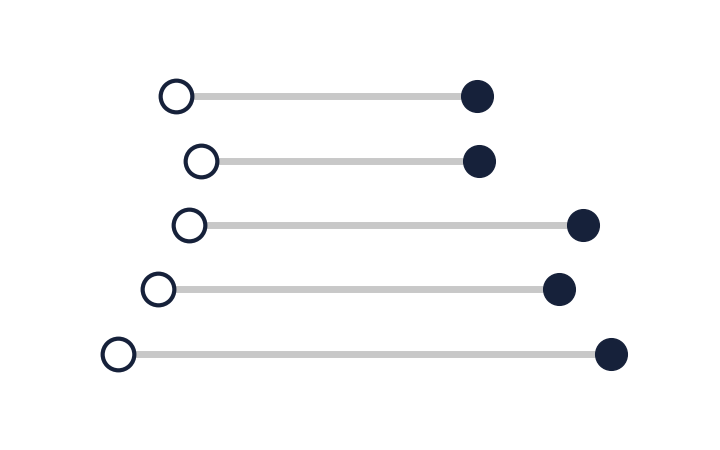
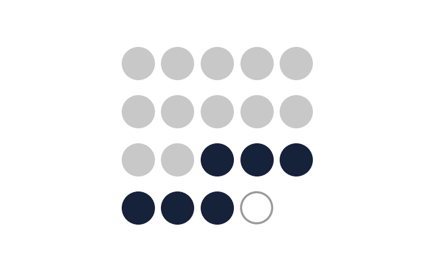
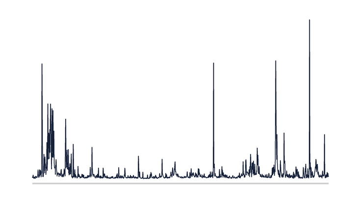
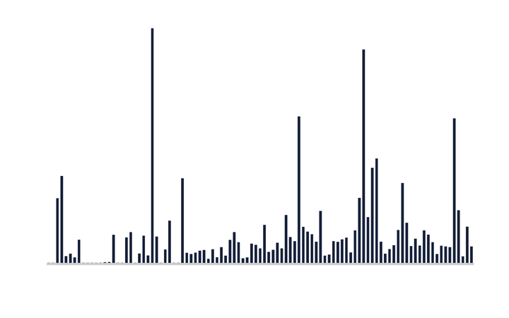



Each project takes a question that portfolio managers meet in practice and works it through on public data, or on licensed data where the question needs them. It is specified in writing before it runs, and its write-up states the question, the data, the method and the result, including where the result was null, with links to the code so the analysis can be reproduced.

Portfolio construction

<a href="/projects/optimal-vs-naive-diversification/">Optimal versus naive diversification</a>

Under an index-tracking mandate on French's 49 industries, five covariance estimators understate their own tracking error, by 22 to 61 per cent. The replication of DeMiguel, Garlappi and Uppal (2009) reproduces 29 of the 30 Sharpe ratios that carry a band.

<a class="btn btn--info btn--small" href="https://www.carlohofer.com/optimal-vs-naive-diversification/dashboard/B-P_dashboard.html" target="_blank" rel="noopener"><i class="fas fa-chart-line" aria-hidden="true"></i> Dashboard</a> <a class="btn btn--inverse btn--small" href="https://github.com/ochofer/optimal-vs-naive-diversification" target="_blank" rel="noopener"><i class="fab fa-github" aria-hidden="true"></i> Code on GitHub</a>

Ownership and prices

<a href="/projects/climate-risk-equity-signal/">Climate risk as an equity signal</a>

An ownership graph linking 328 listed companies to the 5,115 tracked assets they own. Of 19 apparent ownership changes checked by hand, 12 had no transaction behind them.

<a class="btn btn--info btn--small" href="https://github.com/ochofer/paper1-hazard-exposure-data/releases/download/note-v1.2/what-a-vintage-difference-measures.pdf" target="_blank" rel="noopener"><i class="fas fa-file-pdf" aria-hidden="true"></i> Note (PDF)</a> <a class="btn btn--inverse btn--small" href="https://github.com/ochofer/paper1-hazard-exposure-data" target="_blank" rel="noopener"><i class="fab fa-github" aria-hidden="true"></i> Code on GitHub</a>

Signal evaluation

<a href="/projects/volatility-managed-portfolios/">Volatility-managed portfolios: a replication, the real-time critique, and the months after the sample</a>

Volatility estimation and position sizing on Ken French's equity factors, backtested out of sample and without look-ahead, replicating Moreira and Muir (2017) and Cederburg, O'Doherty, Wang and Yan (2020). In build: the data and the signal are in place, and nothing in it is a result yet.

<a class="btn btn--inverse btn--small" href="https://github.com/ochofer/volatility-managed-portfolios" target="_blank" rel="noopener"><i class="fab fa-github" aria-hidden="true"></i> Code on GitHub</a>

Stock-level index tracking

<a href="/projects/stock-level-tracking/">A point-in-time benchmark, a long-only mandate, and its performance attribution by sector</a>

A point-in-time S&amp;P 500 universe from CRSP and Compustat, a long-only mandate held close to its cap-weighted benchmark, and an attribution of its active return by sector. In build: the data layer is in place and checked, and nothing of the mandate is a result yet.

<a class="btn btn--inverse btn--small" href="https://github.com/ochofer/stock-level-tracking" target="_blank" rel="noopener"><i class="fab fa-github" aria-hidden="true"></i> Code on GitHub</a>

