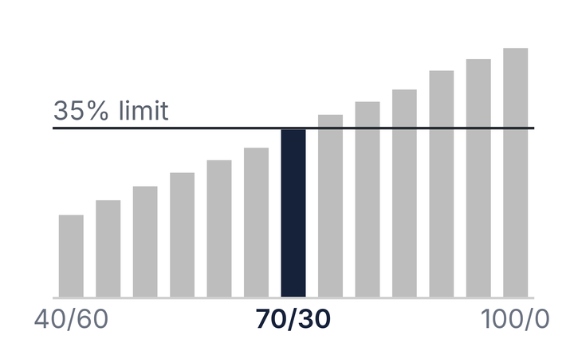



Alongside my other academic research, I also work on quantitative questions in financial markets, using public data. Each project is specified in writing before it runs, and its write-up states the question, the data, the method, and the result, including where the result was null, and links to the code so the analysis can be reproduced.

Portfolio construction

<a href="/projects/optimal-vs-naive-diversification/">Optimal versus naive diversification</a>

Under an index-tracking mandate on French's 49 industries, five covariance estimators understate their own tracking error, by 22 to 61 per cent. The replication of DeMiguel, Garlappi and Uppal (2009) reproduces 29 of the 30 Sharpe ratios that carry a band.

<a class="btn btn--info btn--small" href="https://www.carlohofer.com/optimal-vs-naive-diversification/dashboard/B-P_dashboard.html" target="_blank" rel="noopener"><i class="fas fa-chart-line" aria-hidden="true"></i> Dashboard</a> <a class="btn btn--inverse btn--small" href="https://github.com/ochofer/optimal-vs-naive-diversification" target="_blank" rel="noopener"><i class="fab fa-github" aria-hidden="true"></i> Code on GitHub</a>

Ownership and prices

<a href="/projects/climate-risk-equity-signal/">Climate risk as an equity signal</a>

An ownership graph linking 328 listed companies to the 5,115 tracked assets they own. Of 19 apparent ownership changes checked by hand, 12 had no transaction behind them.

<a class="btn btn--info btn--small" href="https://github.com/ochofer/paper1-hazard-exposure-data/releases/download/note-v1.2/what-a-vintage-difference-measures.pdf" target="_blank" rel="noopener"><i class="fas fa-file-pdf" aria-hidden="true"></i> Note (PDF)</a> <a class="btn btn--inverse btn--small" href="https://github.com/ochofer/paper1-hazard-exposure-data" target="_blank" rel="noopener"><i class="fab fa-github" aria-hidden="true"></i> Code on GitHub</a>

Asset allocation

<a href="/projects/rules-based-portfolio/">Rules-based portfolio</a>

Runs a small real-money portfolio under rules published before the first order: two UCITS ETFs at 70/30, a monthly cycle with pre-trade checks, look-through exposure and ex-ante risk on a public dashboard.

<a class="btn btn--info btn--small" href="https://www.carlohofer.com/rules-based-portfolio/" target="_blank" rel="noopener"><i class="fas fa-chart-line" aria-hidden="true"></i> Dashboard</a> <a class="btn btn--inverse btn--small" href="https://github.com/ochofer/rules-based-portfolio" target="_blank" rel="noopener"><i class="fab fa-github" aria-hidden="true"></i> Code on GitHub</a>

For written analysis aimed at decision-makers, see the two DEMETRA policy briefs under <a href="/publications/">Publications</a>.

